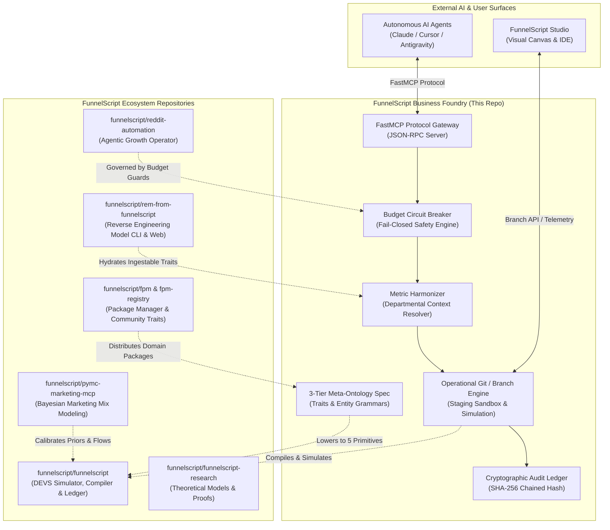

# FunnelScript Business Foundry

> **Enterprise Operational Ontology, FastMCP Governance Core & Strategic Decision Engine for FunnelScript**

[](LICENSE)
[](https://bun.sh)
[](https://www.typescriptlang.org)
[](https://python.org)
[](https://github.com/jlowin/fastmcp)
[](https://postgresql.org)

---

## 1. Overview & Vision

**FunnelScript Business Foundry** provides the **Enterprise Operational Ontology and Autonomous Agent Governance Spine** for the FunnelScript modeling and simulation ecosystem.

Connecting autonomous AI agents directly to raw database drivers or unstructured CRUD endpoints is a catastrophic failure mode in enterprise software:
1. **Semantic Ambiguity**: Cryptic schemas lead to hallucinated metrics (e.g., mistaking Sales "ACV Bookings" for Finance "GAAP Revenue").
2. **State Destruction**: Unfenced mutations violate business invariants and bypass double-entry conservation laws.
3. **Runaway Loops**: Unbounded autonomous loops drain API credits and execute unapproved transactions.

Business Foundry resolves this by translating battle-tested enterprise ontology patterns (demystified from Palantir Foundry and NVIDIA Auto-Ontology) into an open, auditable, and mathematically rigorous execution layer:
- **3-Tier Meta-Ontology Subsystem**: Decouples domain objects from compiler internals via 5 immutable Kernel Primitives and standard Traits.
- **D+L+A Architecture (Data + Logic + Action)**: Strict separation of Nouns (read-only state) and Verbs (action-gated mutations).
- **FastMCP Protocol Gateway**: A type-safe JSON-RPC interface for Claude, Cursor, and Antigravity agents.
- **Budget Circuit Breaker**: Real-time sliding-window rate limiters, financial ceilings, and fail-closed tripwires.
- **Operational Git / Branch Engine**: Copy-on-Write staging sandboxes, blast-radius simulation, and atomic write-back with SHA-256 cryptographic audit chaining.

---

## 2. FunnelScript Ecosystem Linkage Map

Business Foundry acts as the **central operational brain and governance gate** connecting language runtimes, visual interfaces, data pipelines, and external AI agents across the FunnelScript suite:



### Complete Ecosystem Repository Matrix

| Repository | Role in FunnelScript Ecosystem | Integration Contract with Business Foundry |
| :--- | :--- | :--- |
| **[`funnelscript/funnelscript`](https://github.com/funnelscript/funnelscript)** | Core Language, DEVS Event Machine, AST Compiler, Lowering Pass, and Double-Entry Ledger. | Business Foundry authors the `spec/meta-ontology-traits-v1.md` and `spec/grammar.ebnf` that `funnelscript` compiles into the 5 Kernel Primitives. |
| **[`funnelscript/funnelscript-studio`](https://github.com/funnelscript/funnelscript-studio)** | Visual Node-Graph Canvas, Real-Time Financial Runway Visualizer, and Simulation Studio. | Consumes Business Foundry's Branching Engine to provide visual sandbox staging, "What-If" branching, and circuit-breaker telemetry. |
| **[`funnelscript/business-foundry`](https://github.com/funnelscript/business-foundry)** | Enterprise Operational Ontology, FastMCP Gateway, Metric Harmonizer, and Budget Governance. | **Current Repository**: The central governance spine and specification authority. |
| **[`funnelscript/rem-from-funnelscript`](https://github.com/funnelscript/rem-from-funnelscript)** | Reverse Engineering Model: Go CLI, local web app, and MCP server for investigating acquisition funnels from public evidence. | Maps discovered competitive evidence into typed business entities conforming to Business Foundry's `Ingestable` trait. |
| **[`funnelscript/pymc-marketing-mcp`](https://github.com/funnelscript/pymc-marketing-mcp)** | Bayesian Marketing Mix Modeling (MMM) MCP Server. | Calibrates conversion flow probabilities and media spend responses in the ontology against posterior distributions. |
| **[`funnelscript/reddit-automation`](https://github.com/funnelscript/reddit-automation)** | Fast, local-first agentic operator in Rust with MCP support. | Constrained by Business Foundry's Budget Circuit Breaker and human-in-the-loop triggers before dispatching outbound actions. |
| **[`funnelscript/funnelscript-research`](https://github.com/funnelscript/funnelscript-research)** | Theoretical foundations, stochastic calculus, and research documentation. | Supplies the foundational mathematical models codified in the Meta-Ontology specifications. |
| **[`funnelscript/fpm`](https://github.com/funnelscript/fpm) & `fpm-registry`** | Package manager and registry for FunnelScript domain packages. | Publishes Tier 3 domain packages (`ecommerce/d2c_scale`, `leadgen/sales_capacity`) verified against Tier 2 Core Traits. |

---

## 3. Architecture Deep-Dive

### 3.1 The 3-Tier Meta-Ontology Model

Instead of bloating the core compiler with hardcoded industry assumptions, FunnelScript implements a 3-tier layering:

```
+-------------------------------------------------------------------------+
| TIER 3: Community & Industry Packages (via fpm)                         |
| e.g. ecommerce/d2c_scale, leadgen/sales_capacity, marketing/saas_plg    |
| Defines domain entities (CODParcel, SalesLead, Seat)                    |
+-------------------------------------------------------------------------+
                                 | implements
                                 v
+-------------------------------------------------------------------------+
| TIER 2: Core Interoperability Traits (core/commerce_traits)             |
| Standard protocols: FinancialBinding, Capacitated, TimeDelayed,         |
|                     Attributable, Ingestable, CohortEntity              |
+-------------------------------------------------------------------------+
                                 | lowers statically to (zero reflection)
                                 v
+-------------------------------------------------------------------------+
| TIER 1: FunnelScript Kernel Behavioral Primitives (5 Built-ins)         |
| Pool<T>, Flow<T>, LedgerAccount<C>, CapacityGuard, Metric               |
| Understood natively by DEVS Event Machine, Ledger, Linter, & Solver     |
+-------------------------------------------------------------------------+
```

### 3.2 The 4 Governance Subsystems (`ontology-governance-core`)

The TypeScript runtime under `ontology-governance-core/` implements four core components:

1. **Metric Harmonizer (`metric-harmonizer.ts`)**:
   - Resolves ambiguous metric names by enforcing department-contextual resolution (`finance` $\to$ GAAP Revenue, `sales` $\to$ ACV Bookings, `growth` $\to$ Cash Collections).
   - Prevents AI agents from comparing incompatible metrics or calculating erroneous ROAS.
2. **Budget Circuit Breaker (`circuit-breaker.ts`)**:
   - Maintains real-time rate limiting, sliding-window financial budget tracking, and consecutive error tripwires.
   - Enforces a strict **Fail-Closed** policy: once tripped, all mutating actions are hard-blocked until administrative override.
3. **Operational Git & Branch Engine (`branch-engine.ts`)**:
   - Provides Git-style branching (`create_branch`, `propose_action`, `simulate_branch`, `merge_branch`).
   - Executes simulated blast-radius evaluations before write-back.
   - Requires Human-in-the-Loop (HITL) approval when liability thresholds are exceeded.
4. **FastMCP Server (`fastmcp-server.ts`)**:
   - Production FastMCP gateway exposing tools for ontology lookup, metric resolution, action proposal, and simulation.

---

## 4. Repository Structure

```
Business-Foundry/
├── .github/workflows/
│   └── ci.yml                            # Automated CI (test, typecheck, lint)
├── docs/
│   ├── meta-ontology/                    # Master architectural specs & roadmaps
│   │   ├── 01_VISION_AND_ARCHITECTURE.md
│   │   ├── 02_IMPLEMENTATION_ROADMAP.md
│   │   ├── 03_ANTI_PATTERNS_AND_GUARDRAILS.md
│   │   └── 04_TESTING_AND_VERIFICATION.md
│   └── concordia-integration/            # Agentic behavioral simulation specs
├── ontology-governance-core/              # TypeScript / Bun Governance Core
│   ├── src/
│   │   ├── branch-engine.ts              # Operational Git branching & staging
│   │   ├── circuit-breaker.ts            # Budget & runaway safety limiter
│   │   ├── fastmcp-server.ts             # FastMCP JSON-RPC server gateway
│   │   ├── metric-harmonizer.ts          # Departmental metric resolver
│   │   ├── types.ts                      # Core interfaces & Zod schemas
│   │   └── index.ts                      # Library entry point
│   ├── tests/
│   │   └── governance-core.test.ts       # 11 unit & integration tests
│   ├── package.json
│   └── tsconfig.json
├── spec/
│   ├── meta-ontology-traits-v1.md        # Formal Trait & Entity contract spec
│   ├── grammar.ebnf                      # Extended FunnelScript grammar
│   ├── operational-ontology-governance-core.md # D+L+A architecture specification
│   └── ontology_governance_schema.sql    # PostgreSQL 16+ production schema
├── META_ONTOLOGY_STATE.json              # Machine-readable phase milestone ledger
├── tasks.md                              # Master execution & release gate tracker
├── pyproject.toml                        # Python package configuration
├── package.json                          # Bun workspace root configuration
├── LICENSE                               # MIT License
└── README.md                             # This documentation
```

---

## 5. Quickstart & Usage

### Prerequisites
- [Bun](https://bun.sh) (v1.1 or higher)
- [Python](https://python.org) (v3.12 or higher)
- [PostgreSQL](https://postgresql.org) (v16+, optional for local schema evaluation)

### Running Governance Core Tests
```bash
# Clone the repository
git clone https://github.com/funnelscript/business-foundry.git
cd business-foundry

# Run the test suite via Bun
bun run test

# Run strict TypeScript typecheck
bun run typecheck
```

### Starting the FastMCP Server
```bash
# Start the FastMCP gateway (listens on stdio for MCP clients)
bun run start
```

### Connecting to Claude Desktop / Cursor / Antigravity

Add the following to your `claude_desktop_config.json` or Antigravity MCP settings:

```json
{
  "mcpServers": {
    "business-foundry": {
      "command": "bun",
      "args": ["run", "/path/to/business-foundry/ontology-governance-core/src/fastmcp-server.ts"]
    }
  }
}
```

Available FastMCP Tools:
- `resolve_metric`: Resolves certified metrics given an ambiguous name and department context.
- `propose_operational_action`: Stages a business action onto a sandboxed operational branch.
- `simulate_branch`: Runs precondition checks and blast-radius calculation on a staged branch.
- `merge_operational_branch`: Performs atomic write-back with cryptographic SHA-256 audit chaining.
- `get_governance_status`: Inspects circuit-breaker health, budget consumption, and trip status.

### Applying the PostgreSQL Schema
```bash
psql -h localhost -U postgres -d funnelscript_db -f spec/ontology_governance_schema.sql
```

---

## 6. Testing & Quality Gates

Business Foundry enforces strict verification gates across all subsystems:
- **Unit & Protocol Tests**: 100% pass rate across all 11 governance core and FastMCP contract tests.
- **Type Safety**: Zero TypeScript compiler errors (`tsc --noEmit` in strict mode).
- **Double-Entry Financial Invariant**: $\sum \text{Debits}_c(t) - \sum \text{Credits}_c(t) = 0$ enforced at integer minor unit precision.
- **Fail-Closed Budgeting**: Verified threshold trips under simulated API / financial overload.

---

## 7. License

Distributed under the **MIT License**. See [LICENSE](LICENSE) for details.

Copyright (c) 2026 FunnelScript Authors.
