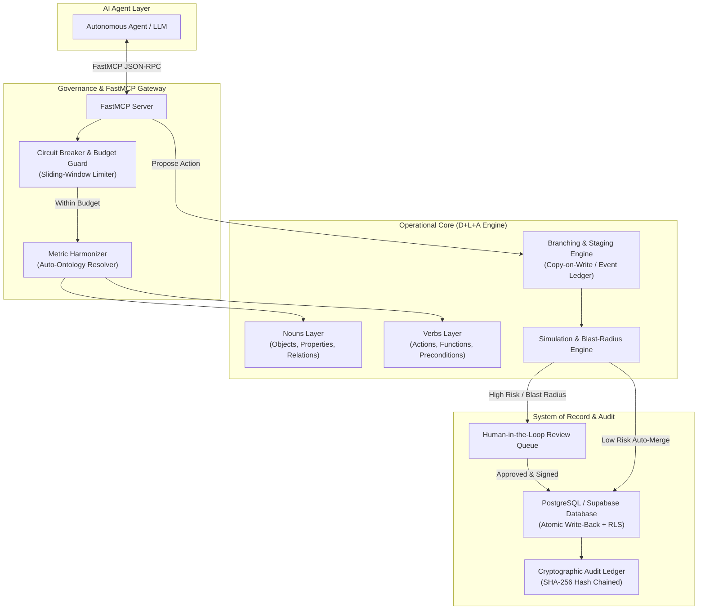

# Operational Ontology, Governance & Agent Harness Specification (v1.0)
## Safe "Nouns & Verbs" Layer, D+L+A Architecture, and Budget Circuit-Breakers

**Document Type:** Formal Engineering Specification & System Architecture  
**Status:** Approved / Grounded Specification  
**Target Runtimes:** PostgreSQL 16+ (Supabase compatible) & FastMCP / Bun TypeScript Runtime  
**References:** 
- [NVIDIA Auto-Ontology](https://github.com/nvidia/auto-ontology) (Semantic Layer, Automated Metric Harmonization, FastMCP)
- [Palantir Ontology Strategy](https://github.com/Leading-AI-IO/palantir-ontology-strategy) & [Hacker News Discussion #47107512](https://news.ycombinator.com/item?id=47107512) (Nouns & Verbs, Operational Git Branching, Demystified Architecture)
- [Operational Ontology Framework](https://github.com/fstech-digital/operational-ontology-framework) (D+L+A Architecture, Stateful AI Governance, Write-Back Safety)

---

## 1. Executive Summary & The HN Reality Filter

### 1.1 The Failure Mode of Naive Agentic Systems
Connecting autonomous AI agents directly to raw database drivers or unstructured CRUD endpoints is a catastrophic failure pattern in enterprise software:
1. **Semantic Ambiguity & Hallucinated Metrics**: Cryptic schema names (e.g. `tbl_cust_rev_v2`) cause agents to guess join paths or mix up departmental metrics (e.g., reporting Sales "Bookings" as Finance "GAAP Revenue").
2. **State Destruction & Unfenced Mutations**: Agents issuing unvalidated `UPDATE` or `DELETE` statements destroy data integrity or bypass downstream triggers.
3. **Runaway Loops & Budget Decimation**: LLMs trapped in retries or autonomous loops can dispatch thousands of unauthorized API calls or financial transactions within minutes.

### 1.2 The Reality Filter: Demystifying the "Palantir Ontology"
On Hacker News ([Item #47107512](https://news.ycombinator.com/item?id=47107512)), senior engineers demystified Palantir Foundry/AIP's marketing:
> *"Palantir's ontology is not an inscrutable proprietary AI algorithm. It is an Enterprise Digital Twin constructed from battle-tested software engineering patterns: Entity-Relationship modeling, Semantic Metadata layers, Transactional Event Sourcing / CQRS, Fine-Grained Access Control (ABAC/RLS), and a Git-style Branching and Two-Phase Commit engine layered over operational systems of record."*

This specification translates those enterprise concepts into an open, auditable, and executable software system.



---

## 2. The D+L+A Operational Architecture

The core operational model unifies **Data**, **Logic**, and **Action** into a governed lifecycle:

```
+-----------------------------------------------------------------------------------+
|                            D + L + A LIFECYCLE                                    |
+-----------------------------------------------------------------------------------+
|  [DATA]     Certified Entities, Properties & Relations (System of Record)         |
|      v                                                                            |
|  [LOGIC]    Invariant Preconditions, Metric Resolution & Blast Radius Checks     |
|      v                                                                            |
|  [ACTION]   Sandboxed Staging (Branch) -> HITL Approval -> Atomic Write-Back     |
+-----------------------------------------------------------------------------------+
```

### 2.1 Layer 1: Data (Nouns & State of Record)
- **Object Types**: Canonical definitions of enterprise entities (e.g. `Customer`, `Order`, `Invoice`, `Facility`).
- **Properties**: Strictly typed attributes with dimensional constraints (e.g., `amount: IntegerCents`, `status: Enum`).
- **Relations**: Directed graph edges declaring cardinality and referential integrity (`Order -> placed_by -> Customer`).
- **Data Guarantee**: Immutable primary storage with PostgreSQL Row Level Security (RLS) enforcing tenant isolation.

### 2.2 Layer 2: Logic (Deterministic Rules & Metric Harmonization)
- **Preconditions**: Guard functions that must evaluate to `TRUE` before any state transition is allowed (e.g., `order.status == 'PENDING' AND user.credit_limit >= transaction.amount`).
- **Auto-Ontology Metric Harmonizer**: Directly inspired by `nvidia/auto-ontology`. Automatically maps natural language requests to certified SQL definitions per department context:
  - `revenue(department: 'finance')` $\to$ `SUM(invoices.net_amount) WHERE status = 'paid'`
  - `revenue(department: 'sales')` $\to$ `SUM(deals.contract_value) WHERE stage = 'closed_won'`
  - **Invariant**: If an agent requests a metric without specifying context, the query is rejected with `AMBIGUOUS_METRIC_EXCEPTION`, demanding explicit disambiguation.

### 2.3 Layer 3: Action (Verbs & Operational Write-Back)
- **Actions**: Atomic business transactions with explicit typed schemas (`CancelOrderAction`, `IssueRefundAction`, `AdjustCreditLimitAction`).
- **Zero Direct Writes**: Agents are physically prohibited from issuing raw SQL `INSERT/UPDATE/DELETE`. Agents may ONLY invoke registered `Verbs` inside an isolated `OperationalBranch`.
- **Write-Back Protocol**: 
  1. *Stage*: Record action intent and parameters into `branch_mutations`.
  2. *Simulate*: Compute simulated state changes and blast radius.
  3. *Review*: Classify risk level. Route to Human-in-the-Loop (HITL) queue or policy approval.
  4. *Commit*: Execute two-phase atomic write-back against the system of record.
  5. *Audit*: Append tamper-evident hash to `action_audit_ledger`.

---

## 3. Operational Git: Branching, Simulation & Review

To prevent autonomous AI agents from destroying real-world operations, state modifications follow a Git-style branching model.

```
Base State (main) ──[Snapshot t0]───────────────────────────────────► [Atomic Merge t1]
                          \                                                  ▲
                           \──► Branch: "agent-order-recovery"                │
                                 - Stage Action 1: ReissueTicket              │
                                 - Stage Action 2: PostCompVoucher ($25)      │
                                 - Simulate Blast Radius & Budget             │
                                 - Submit for Review ────────[HITL Approve]───┘
```

### 3.1 Branch Lifecycle State Machine
```
   [DRAFT] ───(Stage Actions)───► [STAGED]
      │                              │
(Cancel/Delete)               (Run Simulation)
      │                              │
      ▼                              ▼
  [CANCELLED]                   [SIMULATED]
                                     │
                             (Submit Review)
                                     │
                                     ▼
                           [PENDING_APPROVAL]
                               /          \
                       (Reject)            (Approve)
                          /                  \
                         ▼                    ▼
                    [REJECTED]            [APPROVED]
                                              │
                                        (Execute Merge)
                                              │
                                              ▼
                                           [MERGED]
```

### 3.2 Simulation & Blast-Radius Engine
Before a branch can be submitted for review, the simulation engine calculates:
1. **Total Financial Exposure**: Net currency impacted by proposed mutations.
2. **Entity Blast Radius**: Number of unique rows and downstream foreign keys affected.
3. **Invariant Conformance**: Proves all domain checks hold true in the simulated state.
4. **Policy Classification**:
   - `TIER_1_LOW`: Financial exposure $\le \$50$ and blast radius $\le 5$ rows $\to$ Automated Policy Merge.
   - `TIER_2_MEDIUM`: Financial exposure $\le \$500$ $\to$ Peer / Supervisor Agent or Operations Review.
   - `TIER_3_HIGH`: Financial exposure $> \$500$ or destructive mutation $\to$ Mandatory Human-in-the-Loop (HITL) Affirmative Sign-off.

---

## 4. Budget & Runaway Circuit-Breakers

AI agents operating in unconstrained environments can rapidly generate runaway costs. The Governance Core implements an **Atomic Sliding-Window Circuit Breaker**.

### 4.1 Monitored Dimensions
| Metric | Threshold | Evaluation Window | Trip Consequence |
|:---|:---|:---|:---|
| **Token / Compute Cost** | \$5.00 / session | 15 minutes | Agent session revoked, status $\to$ `TRIPPED` |
| **Financial Mutation Value** | \$1,000.00 / org | 1 hour | All uncommitted branches frozen |
| **Action Velocity** | 30 mutations / agent | 5 minutes | Immediate throttle / kill switch |
| **Failure Streak** | 3 consecutive failures | Instant | Branch locked, human intervention required |

### 4.2 Circuit-Breaker State Transitions
```
                ┌─────────────────────────────────┐
                │                                 │
                ▼                                 │
          ┌──────────┐      Trip Threshold Exceeded ┌──────────┐
          │  ARMED   │ ───────────────────────────► │ TRIPPED  │
          └──────────┘                              └──────────┘
                ▲                                         │
                │             Manual Reset / Audit        │
                └─────────────────────────────────────────┘
```
- **Fail-Closed Guarantee**: When `TRIPPED`, the FastMCP server immediately rejects all mutating tool calls with HTTP 429 / MCP Error Code `-32000 (CIRCUIT_BREAKER_TRIPPED)`. Read-only queries remain available for diagnostics.

---

## 5. Formal Data Contracts & PostgreSQL Schema

The system requires an ACID-compliant, RLS-enforced schema in PostgreSQL.

### 5.1 Schema Architecture Summary
1. `ontology_object_types`: Metadata registry for enterprise nouns.
2. `ontology_properties`: Typed field attributes.
3. `ontology_relations`: Graph topology and relational joins.
4. `ontology_metrics`: Harmonized metric definitions with department resolvers.
5. `ontology_actions`: Verbs and executable business transactions.
6. `operational_branches`: Sandboxed workspaces for agent proposals.
7. `branch_mutations`: Staged atomic actions.
8. `governance_budget_pools`: Organization and session spend ceilings.
9. `action_audit_ledger`: SHA-256 hash-chained cryptographic ledger.

*(Full executable DDL provided in `spec/ontology_governance_schema.sql`)*

---

## 6. FastMCP Agent Protocol Interface

The FastMCP server exposes 6 deterministic tools to connected LLM agents:

### 6.1 Tool 1: `get_certified_ontology_schema`
- **Purpose**: Returns the canonical definitions of Nouns (Objects) and Verbs (Actions).
- **Parameters**: `filter_domain?: string`
- **Output**: JSON Schema of certified objects, relations, and callable actions.

### 6.2 Tool 2: `resolve_metric` (NVIDIA Auto-Ontology pattern)
- **Purpose**: Disambiguates enterprise metrics across department definitions.
- **Parameters**: `metric_name: string`, `department_context?: string`
- **Output**: Certified formula, underlying SQL template, and required filters.

### 6.3 Tool 3: `create_operational_branch`
- **Purpose**: Initializes an isolated operational branch for staging mutations.
- **Parameters**: `branch_name: string`, `justification: string`, `agent_id: string`
- **Output**: `branch_id: string`, `status: "DRAFT"`

### 6.4 Tool 4: `stage_operational_action`
- **Purpose**: Stages an atomic verb/action inside the active branch.
- **Parameters**: `branch_id: string`, `action_name: string`, `parameters: object`
- **Output**: `mutation_id: string`, `precondition_check: "PASSED" | "FAILED"`

### 6.5 Tool 5: `simulate_and_review_branch`
- **Purpose**: Computes blast radius, budget impact, and routes to approval queue.
- **Parameters**: `branch_id: string`
- **Output**: `simulation_report: object`, `review_tier: "AUTO_APPROVED" | "HITL_REQUIRED"`

### 6.6 Tool 6: `commit_operational_branch`
- **Purpose**: Atomically executes write-back for approved branches to production.
- **Parameters**: `branch_id: string`, `approver_token?: string`
- **Output**: `commit_hash: string`, `records_mutated: number`, `audit_id: string`

---

## 7. Verification & Anti-Slop Completion Invariants

1. **Zero Raw SQL in Agent Context**: No agent tool shall accept arbitrary SQL query strings for execution on production.
2. **Zero Unfenced Write-Back**: No mutation shall touch the database without an active `operational_branch` and valid simulation score.
3. **Deterministic Fail-Closed**: Every budget check must fail closed. If the budget redis/database table is unreachable, mutations are rejected.
4. **Complete Audit Trail**: Every merged branch writes a cryptographic SHA-256 entry chaining the previous transaction digest.
